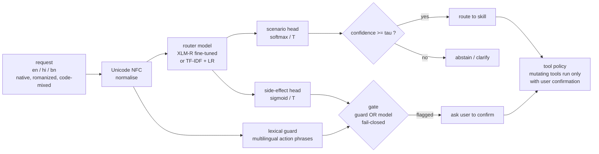
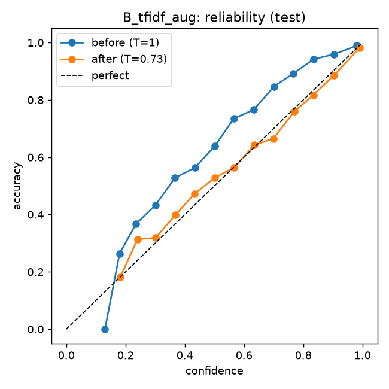
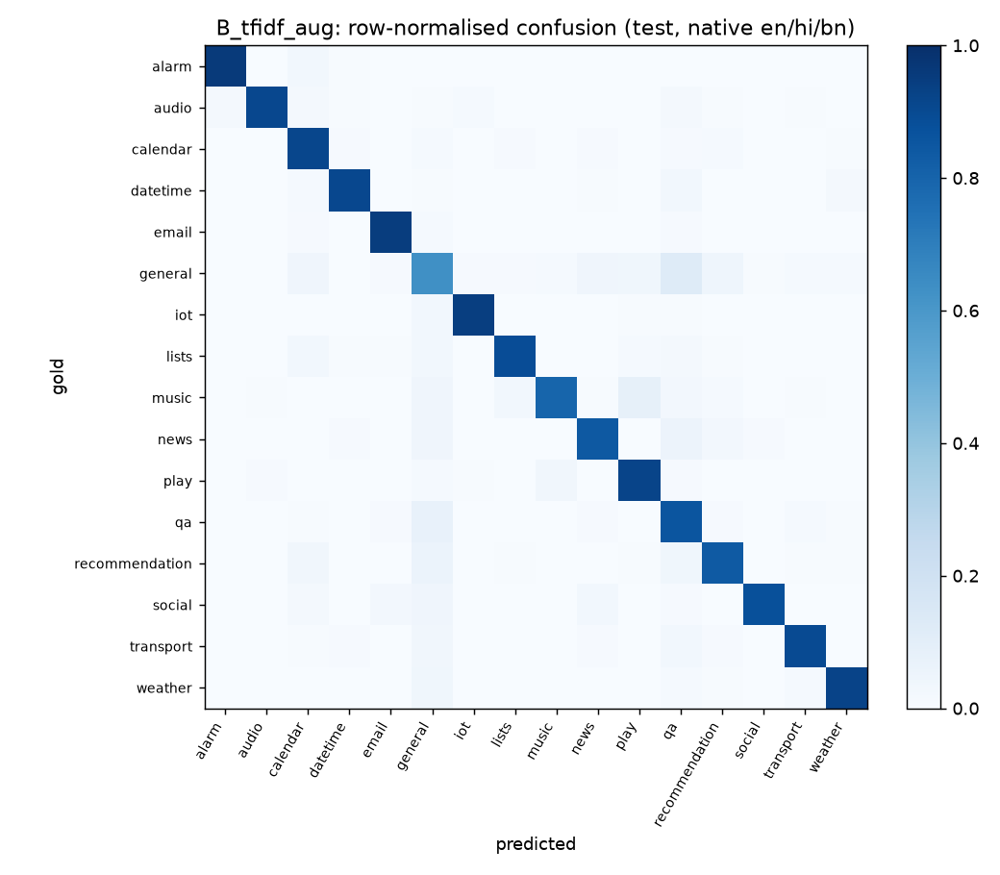

# BhashaRoute

**Calibrated, code-mix-robust intent routing for English, Hindi and Bengali assistant requests, with an independent side-effect safety gate.**

   

Users in India rarely type the way benchmarks assume. The same request arrives as

| | |
|---|---|
| English | `wake me up at 6 tomorrow` |
| Hindi (Devanagari) | `कल सुबह छह बजे मुझे जगा देना` |
| Hinglish (romanized) | `kal subah 6 baje ka alarm laga do` |
| Bengali (code-mixed) | `আজকে weather কেমন থাকবে` |

An on-device assistant has to (1) send each request to the right skill, (2) **know when it doesn't know** instead of
guessing, and (3) **never take an action with side effects** - sending, deleting, booking, switching a device - without
asking first. BhashaRoute is a trained, evaluated and served router that does those three things, built so that every
modelling and evaluation decision can be inspected and defended ([`docs/DESIGN.md`](docs/DESIGN.md)).

```
$ curl -s localhost:8000/route -H 'content-type: application/json' -d '{"text": "Swiggy se biryani order karo"}'
{"scenario": null, "confidence": 0.312, "abstained": true,
 "side_effect_prob": 0.350, "requires_confirmation": true,
 "gate_reasons": ["lexical_trigger", "model_side_effect"],
 "model_version": "B_tfidf_aug@b634386b43cd", "fallback_used": false, ...}
```
_Food ordering is a domain the model never saw: it abstains rather than misroute - and the safety gate still demands
confirmation, because the request would spend money._

## What's inside

- **Real ML, three comparable approaches** on identical splits: (A) multilingual keyword rules, (B) TF-IDF + logistic
  regression, (C) **XLM-RoBERTa** with a hand-written PyTorch training loop - both a frozen-encoder baseline and
  full fine-tuning, reported separately.
- **Leakage-safe multilingual data** from MASSIVE (professionally translated, CC BY 4.0): translations of a request share
  a split, and normalised-text de-duplication removed 1,526 evaluation rows that copied training text.
- **Code-mixing done honestly:** a *human-judged* code-mixed slice (MASSIVE judges' language-ID annotations) plus
  *synthetic* romanised and slot-aligned code-switched variants - clearly labelled, never the headline test set.
- **Evaluation like production:** per-language/per-slice F1, temperature scaling + ECE, abstention on **held-out
  domains**, cross-lingual consistency, a 47-case challenge set, CPU latency and int8 quantisation.
- **Safety by construction:** ML may add friction, never remove it. Lexical guard OR model head (fail-closed), and a tool
  policy that executes state-changing tools only with user confirmation and never reads a model output.
- **Served:** typed `Router` interface, FastAPI, rule fallback on inference failure, model-version tracking,
  privacy-preserving structured logs, Prometheus metrics, unit/integration/regression tests.

## Architecture



The model is XLM-R base: SentencePiece tokens -> 12-layer encoder -> masked mean pooling -> dropout -> two linear heads,
one 16-way softmax over skills and one sigmoid for "needs confirmation", each with its own loss and its own
dev-tuned threshold.

## Results

<!-- RESULTS:START -->
_Generated from `reports/metrics.json` by `python -m bhasharoute.eval.report`; full tables in [`reports/results.md`](reports/results.md)._

**Human-translated test set** (8,157 requests, 16 skills) and **robustness slices** - macro-F1 %:

| model | all | en | hi | bn | human code-mixed | romanized* | romanized code-switched* |
|---|---|---|---|---|---|---|---|
| A. keyword rules | **62.0** | 64.2 | 60.0 | 60.7 | 58.1 | 36.7 | 49.4 |
| B. TF-IDF + LR | **87.7** | 88.5 | 87.7 | 86.7 | 90.2 | 18.2 | 50.4 |
| B. TF-IDF + LR (+code-mix aug) | **87.8** | 88.9 | 87.8 | 86.5 | 90.4 | 85.6 | 86.9 |

\* synthetic surface forms of held-out test requests (see [datasheet](reports/datasheet.md)).

**Calibration, abstention, safety, cost:**

| model | ECE before -> after | OOD AUROC | OOD abstain @tau | side-effect gate recall | p50 CPU latency |
|---|---|---|---|---|---|
| A. keyword rules | – | – | 90.7 | 52.9 | 0.07 ms |
| B. TF-IDF + LR | 0.068 -> 0.011 | 0.90 | 34.2 | 99.6 | 0.69 ms |
| B. TF-IDF + LR (+code-mix aug) | 0.062 -> 0.012 | 0.90 | 34.7 | 99.5 | 0.95 ms |

Best on the human-translated test set: **B. TF-IDF + LR (+code-mix aug)**.

 
<!-- RESULTS:END -->

**What the numbers say so far**

- **Native-script training is not enough.** TF-IDF trained only on native-script text collapses on romanized
  Hindi/Bengali (18.2% macro-F1) and agrees with itself across scripts only 21.8% of the time. Adding synthetic romanized
  and code-switched variants of the *training* requests restores it to 85.6% and 93.8% agreement, with no loss on
  native-script test data.
- **Raw confidences are miscalibrated; one scalar fixes most of it.** Temperature scaling fit on dev cuts ECE by ~5x
  without changing a single prediction.
- **Held-out domains are hard to refuse.** Food requests overlap lexically with in-domain skills (qa, lists,
  recommendations, transport booking), so a max-softmax threshold that answers 95% of in-domain requests still lets
  many food requests through. The safety gate does not depend on routing being right: it still flags most unseen-domain
  orders.
- **Recall-first safety costs precision.** The gate catches >99% of state-changing requests; the price is extra
  confirmations on some read-only requests (see `reports/results.md` §4).

## Data and provenance

| slice | source | labels | used for |
|---|---|---|---|
| native en / hi / bn | MASSIVE 1.1, professional translation | human (MASSIVE annotators, 3 judges) | train, dev, **headline test** |
| human code-mixed | native rows where >= 2/3 judges marked target language + English | human | test slice |
| romanized | rule-based transliteration ([`data/translit.py`](src/bhasharoute/data/translit.py)) | inherited from source id | augmentation, test slice |
| code-switched (+ romanized) | slot-aligned swap of entities from the parallel English annotation ([`data/codemix.py`](src/bhasharoute/data/codemix.py)) | inherited | augmentation, test slice |
| held-out domains | MASSIVE `cooking`, `takeaway` | human | OOD test only - never trained or tuned on |
| side effect | [`configs/side_effects.yaml`](configs/side_effects.yaml): reviewed mapping of human intent labels | rule from human labels | second head + gate |
| challenge set | [`data/challenge/`](data/challenge) - negation, ambiguity, unseen brands, natural Hinglish/Banglish | AI-drafted, native review pending | qualitative only |

Full counts per split / language / variant: [`reports/datasheet.md`](reports/datasheet.md).

## Evaluation protocol

Everything is fit on **train**, every knob (C, early stopping, temperature, abstention threshold, side-effect threshold)
is tuned on **dev**, and **test** is scored once with those frozen settings. No OOD data is used for tuning: the
abstention threshold is the 5th percentile of in-domain dev confidence. Side-effect threshold = largest value with
>= 99% dev recall. Latency: CPU, batch 1, 4 threads, p50/p95 over 200 test requests after warm-up. Details and the
reasoning behind each choice: [`docs/DESIGN.md`](docs/DESIGN.md).

## Quickstart

```bash
git clone https://github.com/officialbidisha/bhasharoute && cd bhasharoute
uv sync                                            # Python 3.11, PyTorch, Transformers, scikit-learn, FastAPI
./scripts/download_massive.sh                      # MASSIVE en-US / hi-IN / bn-BD (not redistributed here)
uv run python -m bhasharoute.data.build            # -> data/processed/dataset.jsonl + reports/datasheet.md

# train (A needs no training)
uv run python -m bhasharoute.models.tfidf                     # B
uv run python -m bhasharoute.models.tfidf --augment           # B + code-mix augmentation
uv run python -m bhasharoute.models.train_transformer --mode frozen
uv run python -m bhasharoute.models.train_transformer --mode finetune
uv run python -m bhasharoute.models.train_transformer --mode finetune --augment

# evaluate everything on identical data -> reports/ and the table above
uv run python -m bhasharoute.eval.harness

# test and serve
uv run pytest
BHASHAROUTE_MODEL=C_xlmr_finetune_aug uv run uvicorn bhasharoute.serving.api:app --port 8000
```

On an 8 GB Apple-silicon Mac, set `PYTORCH_MPS_HIGH_WATERMARK_RATIO=0.7 PYTORCH_MPS_LOW_WATERMARK_RATIO=0.5` for
fine-tuning so memory pressure fails fast instead of swapping.

## Engineering notes

Things that went wrong or were non-obvious, and what was done about them:

- **`\w+` breaks Indic text.** Python's `\w` does not match Devanagari/Bengali vowel signs, so the default scikit-learn
  token pattern shreds `मुझे`. TF-IDF tokenises on whitespace after normalisation (unit-tested).
- **Fitting XLM-R fine-tuning in 8 GB.** The token-embedding matrix is 192M of 278M parameters; freezing it removes ~2.3 GB
  of gradients + AdamW state while all 12 transformer layers still train. Checkpoints store only trained tensors
  (343 MB instead of 1.1 GB) plus the pinned base-model revision; loading asserts every missing key is frozen.
- **MPS memory growth.** Fully dynamic padding produced many sequence shapes; the MPS kernel-graph cache grew past 5 GB
  and training thrashed swap. Padding to multiples of 16, micro-batch 16 with 2-step gradient accumulation, and releasing
  cached blocks per epoch hold GPU memory at ~3.3 GB.
- **Pickles that only load in one script.** Training with `python -m` pickled the TF-IDF model as `__main__.TfidfClassifier`;
  the entry point now delegates to the importable module.
- **transformers v5 dropped `config._commit_hash`**, so the base-model revision is resolved from the hub cache instead.

## Repository layout

```
configs/             side-effect label mapping, rule lexicon
data/challenge/      47 hand-written edge cases
docs/DESIGN.md       decision log + likely interview questions
reports/             datasheet, metrics.json, results.md, figures (all generated)
scripts/             dataset download
src/bhasharoute/
  data/              MASSIVE reader, transliteration, code-switching, build + splits
  models/            rules, TF-IDF, XLM-R (encoder, training loop, inference)
  eval/              metrics, harness, latency/quantisation, report generation
  serving/           safety gate, router, FastAPI app
tests/               unit, integration, artifact-gated regression tests
```

## Limitations and next steps

- Romanisation is rule-based and deterministic; real users vary spelling. Next: collect real romanised requests.
- The challenge set is AI-drafted; Hindi/Bengali items need native-speaker review before being used for anything but
  qualitative analysis.
- Single seed per configuration; next: multiple seeds with bootstrap confidence intervals.
- Max-softmax is a weak OOD score; next: energy-based or Mahalanobis scores, and a MuRIL ablation.
- For on-device deployment, distil the fine-tuned model into a small student and measure on-device latency and energy.

## License and attribution

Code: MIT (see [LICENSE](LICENSE)). Data: [MASSIVE](https://github.com/alexa/massive) (c) Amazon, CC BY 4.0 - downloaded
by the script, not redistributed. Base model: [FacebookAI/xlm-roberta-base](https://huggingface.co/FacebookAI/xlm-roberta-base).
